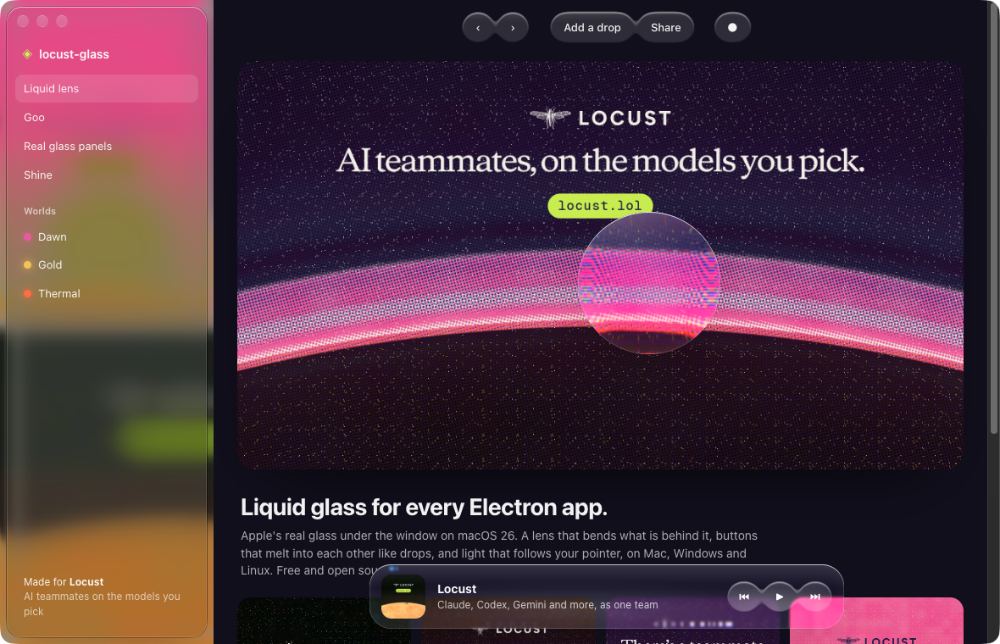
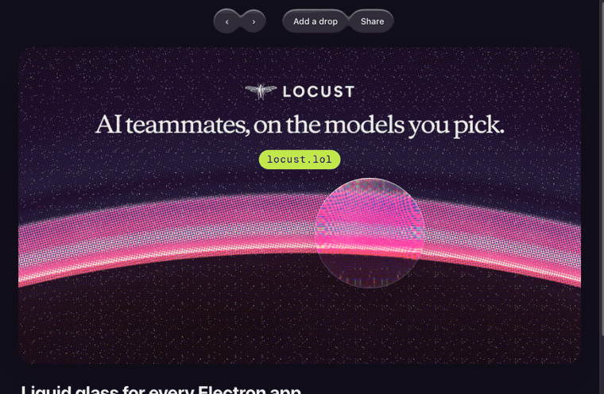
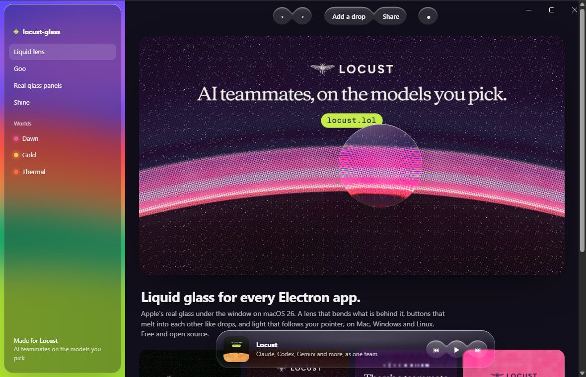
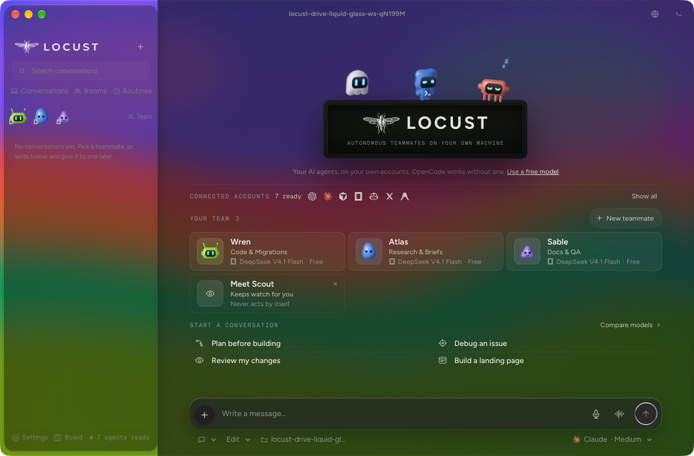
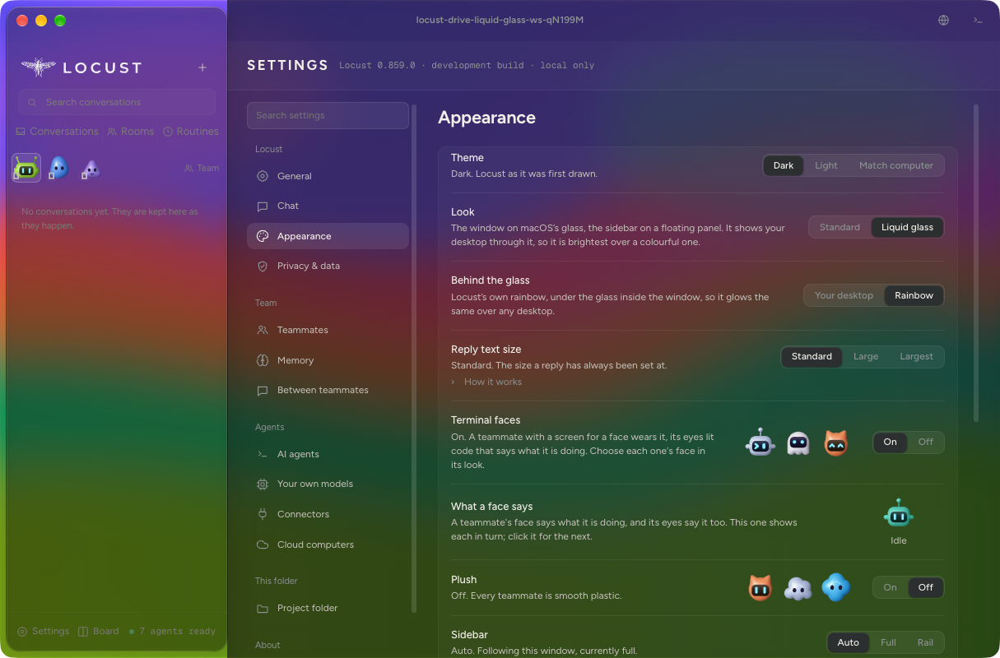

# locust-glass

**Liquid glass for Electron.** Apple's real glass under your window on macOS 26, Windows' Acrylic on Windows 11, and the bubbly part on every system: a lens that bends what is behind it, buttons that melt into each other like drops of water, and light that follows the pointer. Free and open source (MIT).





## On Windows 11

The same demo on Windows 11 24H2, taken by the **screens** workflow: Windows' own buttons over the page, the lens bending the art, the toolbar melted into one sheet, and the Rainbow under the sidebar's frosted panel.



## Locust, built on it

This is the glass [Locust](https://locust.lol) is drawn on: the sidebar on a floating panel of Apple's glass, the window buttons in its corner, and here **Rainbow** under the glass.





Made for **[Locust](https://locust.lol)**, the free app that puts Claude Code, Codex, Gemini, Cursor, Copilot and OpenCode on one team on your own computer. This is the glass its Mac look is built on, given away.

## What you get

| | macOS 26+ | Windows 11 22H2+ | macOS 11–15, Windows 10, Linux |
| --- | --- | --- | --- |
| The window on the system's glass | Apple's (`NSGlassEffectView`) | Acrylic, or Mica | falls back to the window as you made it |
| Floating panels where your page says | real glass under each | the page's rim over the Acrylic | the page's own frost |
| Title bar hidden, the system's buttons over the page | yes, inside the sidebar panel's corner | yes, Windows' own at the top right | n/a |
| A picture under the glass (`backdrop`, `RAINBOW`) | under Apple's glass | painted by the page, frosted by the panels | n/a |
| Lens: the backdrop bends at the rim, with a prism fringe | yes | yes | yes (any Chromium) |
| Goo: shapes melt together and drip apart | yes | yes | yes |
| Squishy buttons, pointer-lit shine, lit rims | yes | yes | yes |
| Light and dark, reduced motion | yes | yes | yes |

Nobody's code was copied: the native part is ~200 lines of Objective-C over Apple's public API, Windows' glass is Electron's own `setBackgroundMaterial`, and the page part is plain DOM, canvas and SVG filters. Tested on macOS 26 with Electron 44, and on Windows 11 24H2 (Windows Server 2025, build 26100) and Ubuntu 24.04 by the **screens** workflow, which runs the demo over a window of colour stripes and takes the screen through the system. The page layer has no platform code of its own, only Chromium features.

On Windows the blur is the graphics card's: with no card (as on CI's virtual machines), or with **Transparency effects** off in Settings, Windows paints Acrylic's plain stand-in colour instead, and the page reads as a dark or light frosted window. Acrylic is tinted by your app's theme, so set `nativeTheme.themeSource` to match your page.

## Install

```bash
npm install github:StopBanning/locust-glass
```

On a Mac the install builds a small native addon with `clang` (Xcode's command line tools); there is no `node-gyp` and nothing to download. Anywhere else it builds nothing, and everything on the page still works.

## Use it

**Main process**: make the window, then put it on glass.

```js
import { app, BrowserWindow } from 'electron'
import { glassWindowOptions, applyGlass } from 'locust-glass'

app.whenReady().then(() => {
  const win = new BrowserWindow({
    ...glassWindowOptions(),          // hidden inset title bar, buttons where the sidebar panel's corner will be
    width: 1100,
    height: 720,
    webPreferences: { preload: new URL('./preload.cjs', import.meta.url).pathname }
  })
  win.loadFile('index.html')
  win.webContents.once('did-finish-load', () => applyGlass(win))   // true on macOS 26+ and Windows 11 22H2+, false elsewhere
})
```

**Preload**: one line.

```js
require('locust-glass/preload')
```

**Page**: mark what floats, then turn it on.

```html
<link rel="stylesheet" href="node_modules/locust-glass/src/glass.css">

<aside class="lg-panel" data-glass-panel="sidebar" data-glass-follow>…</aside>   <!-- real glass under it on a Mac -->

<div class="toolbar" data-goo>                                                    <!-- one melting sheet of glass -->
  <button class="lg-pill">Back</button>
  <button class="lg-pill">Forward</button>
</div>

<div class="card" data-lens data-shine>…</div>                                   <!-- bends what is behind it -->

<script type="module">
  import { glassPage } from 'locust-glass/renderer'
  glassPage()
</script>
```

The window's glass shows the desktop. A lens and goo bend and frost **what the page draws behind them**, so put them over content: a photo, a list, a document scrolling underneath, as Apple's own toolbars float over it.

## The pieces

### Main process (`locust-glass`)

- `glassWindowOptions()`: `BrowserWindow` options for a glass window: the title bar hidden, with the Mac's buttons inside the sidebar panel's corner and Windows' own over the page's top right (keep that corner clear).
- `applyGlass(win, { style, backdrop, windowsMaterial })`: puts the window on glass and answers the page's panels. `style: 'clear'` is macOS's more transparent glass. `backdrop` puts a picture under the glass inside the window, so it glows the same over any desktop: on a Mac under Apple's glass, on Windows painted by the page under everything (the page's Content-Security-Policy must allow `img-src file:`). `windowsMaterial: 'mica'` asks Windows for its quieter, wallpaper-tinted Mica instead of Acrylic.
- `RAINBOW`: a painting of soft colour to put under the glass, so the window glows the same over any desktop: `applyGlass(win, { backdrop: RAINBOW })`. Try it with `npm run demo -- --rainbow`.
- `removeGlass(win)`: back to the sidebar material (macOS) or no material (Windows).
- `placePanel(win, name, rect | null)`: place a panel yourself. `watchPanels` usually does it for you.
- `glassSupported()`: true on macOS 26+ with the addon built, and on Windows 11 22H2+. `glassKind()` says which: `'mac'`, `'windows'` or `null`.

### Page (`locust-glass/renderer`)

- `watchPanels()`: every `[data-glass-panel="name"]` gets real glass placed under it, following its size and place. Optional `data-glass-radius`, `data-glass-style="clear"`, `data-glass-follow` (a full-height sidebar).
- `lens(element, { bezel, strength, blur, saturate, dispersion })`: the backdrop bends within `bezel` px of the rim, on a circular bevel's curve, and splits into colour at the edge. Uses an SVG displacement map through `backdrop-filter`, which Chromium supports, so it works in every Electron app. Elsewhere it falls back to frost.
- `goo(group, { melt, selector, blur, saturate })`: the group's children share one sheet of glass shaped like all of them: two that come within `melt` px grow a bridge and join, and pull apart with a neck. It redraws only while something in the group moves. Returns `{ wake, stop }`.
- `shine()`: sets `--lg-x` / `--lg-y` under the pointer, so the highlight on `[data-shine]` glass follows it.
- `glassPage()`: all of the above for `[data-glass-panel]`, `[data-lens]` and `[data-goo]`.

### CSS (`locust-glass/glass.css`)

`.lg-surface` (frosted, lit rim, shine), `.lg-panel`, `.lg-lens`, `.lg-pill` (swells on hover, squishes like a drop when pressed, springs back), and the goo layers. Colours are custom properties (`--lg-tint`, `--lg-rim`, `--lg-frost`, `--lg-spring` …), with a light set for `prefers-color-scheme: light` or `<html data-theme="light">`.

## Run the demo

```bash
git clone https://github.com/StopBanning/locust-glass && cd locust-glass
npm install
npm run demo
```

Drag the drop of glass over the art, press **Add a drop**, and hover the buttons. `npm run demo -- --rainbow` puts the Rainbow under it.

## Tested on every system

`npx electron demo/main.mjs --check` tests every piece in the page wherever it runs and fails on any miss: the page knows its glass and clears its ground, panels are glass (real on a Mac, the page's own elsewhere) with a lit rim, both lenses have their maps and bend in three colours, the toolbar's sheet melts two near buttons into one and stays clear between them, a new drop drips out and the sheet reshapes, the light follows the pointer, and the buttons spring (or hold still when the system asks for less motion). With `--rainbow` on Windows it also checks the picture is painted and loads.

The **screens** workflow (Actions, run by hand) runs those checks on Windows 11 24H2 and Ubuntu 24.04 and takes the screen through the system; the Mac runs them locally. Every system passes all of them.

## How it works

- **Real glass.** macOS 26 made `NSGlassEffectView` public. Electron has no option for it, so the addon puts one behind the page for the window's ground, and more for each panel, at the rectangles the page measures. The page paints nothing there, so the glass shows through. The class is looked up by name, so the addon builds on older SDKs and simply says "not here" on older macOS.
- **Windows.** Windows 11's window manager blurs what is behind a window itself (Acrylic), and Electron reaches it with `setBackgroundMaterial`. The window's background goes clear so the Acrylic shows through, `<html data-glass-drawn="windows">` tells the page, and the page draws its panels' rims and tint over it. Windows has no second pane of glass inside a window, so a floating panel is the page's, which reads the same.
- **Lens.** A displacement map for the element's rounded shape is drawn on a canvas once per size: near the rim each pixel looks further inward, steepest at the edge. An SVG `feDisplacementMap` applies it to the backdrop through `backdrop-filter: url(#…)`, three times with slightly different strengths when `dispersion` is on, so red, green and blue bend apart like a prism.
- **Goo.** The children's shapes are drawn blurred onto a canvas and cut at half strength, so where two blurs overlap they add up and join (metaballs). The result masks a frosted sheet under the children, a highlight layer, and a lit top rim (the shape less itself moved down 1.5 px).

## License

MIT. Use it in anything. A link back to [Locust](https://locust.lol) is appreciated, never required.
